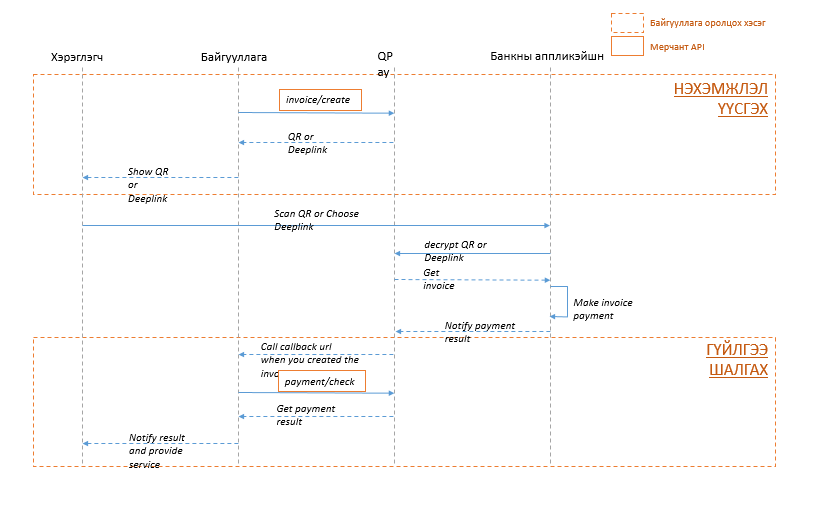

# QPAY



## Example

```bash
    import QPAY from "@togtokh.dev/qpay";

    QPAY.auth
      .TOKEN({
        username: "TOGTOKH_DEV",
        password: "fAjEuRCa",
        invoice_code: "TOGTOKH_DEV_INVOICE",
      })
      .then(async (r) => {
        console.log(QPAY.authInfo);
        await QPAY.auth.REFRESH();
        console.log(QPAY.authInfo);
      })
      .catch((e) => {
        console.log(e);
      });

```
